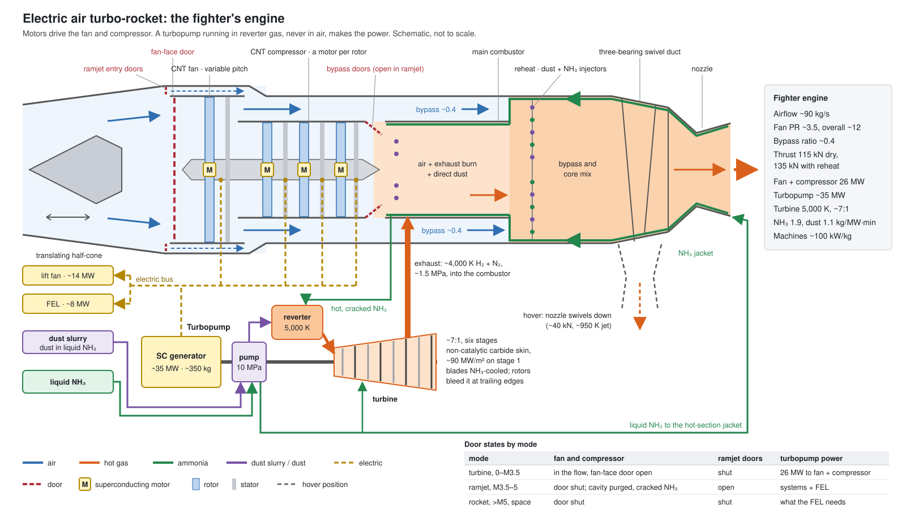

# Small Craft

Couriers cross between stars and never come near a planet. Everything
else that flies in a system — shuttles, fighters, missiles, tugs — is a
small craft. This doc covers the chemical tier: craft that burn **dust**,
the same IS metal the couriers carry, as a chemical fuel — and the
cruiser, which flies on the [ICF drive](icf-drive.md).

Numbers here are first-order, from energy balances and textbook engine
physics. The dust chemistry and the hybrid engine's come from
`crates/hf-engine` (`cargo run -p hf-engine`): NASA thermodynamic data,
chemical equilibrium with dissociation (checked against Cantera), and a
cycle model of the engine.

## The Fuel

Metal that reverts to molecular hydrogen releases **216 MJ/kg** (see
[Ship Systems — The Metal](ship-systems.md#the-metal)). It does so with
no oxidizer: heat a grain past ~1000 K and it gives up its energy by
itself. In air the hydrogen it becomes can then burn as well.

| Fuel | Energy | Density | Needs |
|---|---|---|---|
| Jet fuel | 43 MJ/kg | 0.8 t/m³ | oxygen |
| Liquid hydrogen | 120 MJ/kg | 0.07 t/m³ | oxygen, cryogenics |
| **Dust, in any gas** | **216 MJ/kg** | **0.6 t/m³ packed** | nothing |
| **Dust, in oxygen air** | **~336 MJ/kg** | | oxygen for the second half |

Dust is the best chemical fuel there is, eight times jet fuel by mass,
dense, warm, and pumpable by magnets. It works in any atmosphere,
breathable or not. It is also IS's, so every shuttle and fighter is on
the same fuel leash as the couriers.

Every kilogram of it is ~50 kg of TNT waiting for heat. A light
shuttle's tanks hold a quarter of a kiloton; a heavy shuttle's, a few
kilotons.

## Dust Rockets

Pure dust reverting in a chamber runs at **~5,600 K** and gives ~1,700 s
of specific impulse (Silvera & Cole, 2010, put it near 6,000 K). No wall
likes 5,600 K. Small craft carry **ammonia** alongside the dust, for
three jobs:

- **Coolant.** Liquid ammonia runs through the walls of every hot part,
  boils, and cracks into nitrogen and hydrogen, soaking up ~12 MJ/kg on
  its way to 2,500 K. Then it is injected as propellant, so the heat is
  not lost. Its products do not attack carbon; steam would.
- **Diluent.** Mixed into the gas, it pulls the temperature down, but
  slowly. Dust carries so much energy that a 1:1 mix still runs at
  5,200 K, and holding the gas to 3,000 K takes 11 kg of ammonia per
  kilogram of dust. Above ~4,000 K much of the energy sits in hydrogen
  split into atoms, which recombine as the gas expands and give it back.
- **Fuel.** In air, cracked ammonia burns (18.6 MJ/kg), so it is not dead
  weight.

It is everywhere — outer-system ices, or made from air, water, and
power — and it stays liquid at modest pressure, with no cryogenics.

| Mix, dust : ammonia | Gas at 10 MPa | Vacuum Isp | Used for |
|---|---|---|---|
| Pure dust | ~5,600 K | ~1,700 s | military performance; needs an exotic chamber |
| 1 : 1 | ~5,200 K | ~1,200 s | the standard rocket mix, with ammonia film along the walls |
| 1 : 1.65 | 5,000 K | — | the turbine gas of the hybrid engine |
| 1 : 2 | ~4,900 K | ~1,000 s | cheap lift |
| 1 : 11 | 3,000 K | — | |

(Equilibrium temperatures; hotter at higher pressure, where less hydrogen
splits. The Isp is ~90% of the ideal of an area-ratio-100 nozzle:
1,840, 1,330 and 1,110 s.)

## The Hybrid Engine

Atmosphere-capable craft fly one engine in three modes. It is an
**electric air turbo-rocket**: motors drive the fan and compressor, and
the power comes from a **turbopump**, a turbogenerator that runs in gas
from the dust **reverter** and never touches air. Nothing turns in the
hot air downstream.

CNT is ideal for the fan and compressor — cold, and strong enough for
very high tip speeds, so a few light stages give a high pressure ratio.
It is the wrong thing to put in hot air: carbon oxidizes above ~900 K.
The turbopump's gas is hydrogen and nitrogen, with no oxygen in it, so
its blades can be CNT too.

### The Turbopump

- **Feed**: dust slurried in liquid ammonia, pumped to ~10 MPa by the
  turbopump's own pump. More ammonia joins it at the reverter, after
  cooling the turbine's blades and the hot section.
- **Reverter**: the dust reverts, the ammonia cracks, and the gas leaves
  at **5,000 K**, with 1.65 kg of ammonia to each kilogram of dust.
  Nearly half its molecules are hydrogen atoms; they recombine through
  the turbine, and much of its work comes from them.
- **Turbine**: six stages expand the gas ~7:1, down to the main
  combustor's pressure. It is small and fast: ~7 cm in radius at
  ~190,000 rpm, its first blades 7 mm long.
- **Blades**: CNT, under an insulating refractory-carbide skin, cooled
  from inside by ammonia. The stators return their coolant to the
  reverter's feed; the rotors bleed theirs out of their trailing edges.
- **Generator**: superconducting, on the turbopump shaft, at ~100 kW/kg.
- **Exhaust**: hydrogen and nitrogen at ~4,000 K and ~1.5 MPa, into the
  main combustor.

**Each megawatt of electricity costs ~1.9 kg of ammonia and ~1.1 kg of
dust a minute.** The exhaust burns downstream, so its energy is not
lost; the ammonia is the price of the work, because the turbine can only
take so much work from each kilogram of gas.

**Why 5,000 K.** The blade's CNT survives ~3,000 K. Its skin, of the
highest-melting materials known, survives ~4,000 K. Cooling holds the
gas ~1,000 K hotter than the skin, as today's turbines run hotter than
their coatings and rockets run far hotter than their walls. Two things
make that possible:

- **The skin is non-catalytic**: hydrogen atoms that reach it do not
  recombine on it, so it does not take their energy. A catalytic skin
  would take twice the heat.
- **The reverter runs at 10 MPa**, not higher. Dense hot hydrogen
  carries heat into a surface very well: at 50 MPa the first blades
  would take ~500 MW/m², and at 10 MPa they take ~90 MW/m², what a
  rocket's throat takes. The whole turbine sheds ~9 MW into its blades,
  and ~60% of its own ammonia, heated to 2,500 K, carries that away.

Hydrogen and nitrogen are nearly transparent, so the blades take little
radiant heat. Hotter would need a skin near 5,000 K, which no known
material survives. At 3,000 K the turbine would need nearly six times
the ammonia per megawatt.

There is no reheat between the turbine's stages. Dust needs no oxidizer,
so stator vanes could inject it and lift the gas back to 5,000 K before
each rotor; at 10 MPa that saves only ~15% of the ammonia, for twice the
dust.

### The Air Path

- **Fan and compressor**: CNT blades, each rotor on its own motor at its
  own speed. Fan pressure ratio ~3.5, overall ~12, bypass ~0.4. As Mach
  rises the compressor slows, to keep its discharge below ~850 K.
- **Main combustor**: compressed air meets the turbopump's exhaust and,
  if it has oxygen, burns it; more dust can be injected directly. No
  turbine follows it, so it can run near stoichiometric.
- **Reheat**: the bypass air joins the core flow at the bypass's
  pressure, and secondary dust and ammonia injectors burn the bypass
  air's oxygen. Mixed, the two streams give 2–4% more thrust than
  separate nozzles would.
- **Cooling**: the whole hot section is ammonia-cooled, and that
  ammonia, cracked and hot, feeds the reverter.

### Modes

| Mode | Speed | Isp, all propellant | Doors |
|---|---|---|---|
| **Turbine** | 0 to Mach ~3.5 | ~6,500–13,000 s | fan and compressor in the flow |
| **Ramjet** | Mach ~3.5 to ~5 | ~7,500–8,800 s | fan face closed; doors in the inlet duct ahead of it open into the bypass duct, which opens through more doors into the main combustor |
| **Rocket** | above Mach ~5, and in space | 900–1,700 s | all closed; the main combustor and reheat are the chamber, and the turbopump runs only for the electricity needed |

Turbine mode's best is cruise; its worst is Mach 2, where ram doubles
the airflow and the fan and compressor would want 49 MW. The ramjet holds
level flight to about Mach 4.5 with its burner at 3,000 K; beyond that
drag outgrows it, and Mach 6 is a dash on the rocket.

In ramjet mode the stopped compressor sits beside duct walls at
1,100–1,800 K, so its cavity is purged with cracked ammonia: hot CNT
cannot burn in it. In an atmosphere with no oxygen the engine still
works, as a pure heat-addition jet: it makes the same thrust by burning
more dust, at 70–80% of the fuel efficiency.

The rocket mode is a poor rocket. The main combustor is a low-pressure
chamber, ~2 MPa, and the aircraft nozzle opens to an area ratio of only
~5–20, so a 1:2 mix gives 900–1,000 s, not 1,100.

There is no scramjet stage. The rocket mode is good enough that one would
save only another ~10% of dust for a great deal of complexity.

**Why bother breathing air:** orbit does not need it — even a pure dust
rocket reaches orbit in one stage with a mass ratio under 2. Air
breathing roughly halves the IS dust each ascent burns, gives
atmospheric craft range and loiter, and keeps a 3,500 K hydrogen jet away
from the ground.

## Heavy Shuttle

About 100 t dry with its payload, ~190 t at liftoff. It flies the hybrid
to Mach ~6 and rockets the rest of the way to orbit, and it lands on its
rocket, so it needs a real pad: hardened, remote, with a water deluge to
take the heat and the noise. To low orbit:

| Profile | Dust per ascent | Ammonia |
|---|---|---|
| Pure dust rocket from the ground | ~87 t (~4.5 kt of TNT) | — |
| 1:1 rocket from the ground | ~72 t | ~72 t |
| Air to Mach 6, then pure dust | ~58 t | — |
| **Air to Mach 6, then 1:1** | **~46 t** | **~43 t** |

Heavy shuttles work between ports' pads and their stations. None reaches a
parked courier, tens of light-seconds out; transfer craft do that leg.

## Light Shuttle

About **20 t fully loaded**, built to land almost anywhere.

- **Lift**: two to four **deployable fans** with folding CNT blades swing
  out of bays on arms once the shuttle is subsonic. Together they sweep
  ~75 m², about three times what fans buried in the body could, so the
  downwash is ~65 m/s of cool air: rough on loose ground, but no pad, no
  deluge, no fire.
- **Drive**: the engine's turbopump feeds superconducting motors in the
  fans. With superconductors that work to ~1000 K there are no
  cryogenics and the machines are light. Differences in fan thrust hold
  attitude in the hover without reaction jets, and losing one fan is not
  fatal. Hovering takes 10–16 MW, which the turbopump makes for
  ~30–50 kg of propellant a minute, 60% of it ammonia.
- **Backup**: the rocket can land the shuttle if the fans fail, at ~1 t of
  propellant a minute and a scorched landing site.

| | Mass |
|---|---|
| Structure, engine, fans, heat shield | ~7.5 t |
| Payload: crew and cargo | ~2–3 t |
| Propellant to orbit (air to Mach 6, then 1:1) | ~10 t, half dust, half ammonia |
| **Loaded** | **~20 t** |

## Fighter

**About 7.5 t empty and ~12 t loaded, with the lines of a Mirage 2000:**
a tailless delta, one fin, half-cone side inlets, one engine, but with a
broader forward fuselage to hold a lift fan. The inlet cones translate,
as the Mirage's do, but much further, to set up the inlet for the
ramjet. The delta's big wing gives it a low landing speed when it uses a
strip.

| Engine | |
|---|---|
| Airflow | ~90 kg/s |
| Thrust, sea level | ~115 kN dry, ~135 kN with reheat |
| Fan and compressor | 26 MW at full thrust at sea level |
| Turbopump | 35 MW: full thrust at sea level and the FEL together |
| Mach 2, 11 km, on 35 MW | ~130 kN with reheat; ~100 kN dry with the FEL firing; drag ~76 kN |
| Electric machines | ~0.85 t: generator ~350 kg, engine motors ~350 kg, lift-fan motor ~150 kg |

**It lifts the way the F-35B does**: an electric ~1.5 m fan behind the
cockpit, with doors above and below and a vane box under it, and the
main engine's nozzle swivelled straight down on a three-bearing duct.
The nozzle sits far aft on a tailless delta, so the fan carries about
two thirds of the weight.

| In the hover | Thrust | Power |
|---|---|---|
| Lift fan | ~75 kN | ~14 MW |
| Engine, nozzle down | ~40 kN | ~6 MW |
| **Total** | **~115 kN** | **~20 MW, ~22 kg of ammonia and ~13 kg of dust a minute** |

In the hover the engine runs its fan slow, at a pressure ratio of ~2.5,
and its compressor idle, so the nozzle passes a lot of air at ~1,400 K
and ~760 m/s. Run at full pressure ratios it would make the same thrust
from a quarter of the air, at ~3,200 K. Variable-pitch fan blades,
passing still more air at a pressure ratio of ~1.3, would bring the jet
to ~950 K.

- **No shaft, no clutch.** The F-35B drives its fan from the engine
  through a driveshaft and clutch; this fan is wired to the turbopump.
  Pitch in the hover is a change of motor torque, in milliseconds.
- **Roll** comes from the wingtip thrusters the fighter uses in space, as
  the Harrier used wingtip puffers. Yaw comes from the fan's vanes and
  the nozzle.
- **Downwash**: ~190 m/s of cool air from the fan, and a ~1,400 K jet
  from the nozzle. The fighter lands on a pad, or on ground it can afford
  to scorch.
- **The wings are tanks.** One fan in the fuselage instead of three
  leaves the wing roots free.
- **A fan or the turbopump lost in the hover** is a hard upset, as it was
  for every lift-fan aircraft. The seat goes.

| | Mass |
|---|---|
| Empty | ~7.5 t |
| Weapons | ~1.5 t |
| Dust | ~1 t |
| Ammonia | ~2 t |
| **Loaded** | **~12 t** |

- **Range**: at Mach 0.9 it cruises on ~0.12 kg/s of propellant, its fan
  at full ratio and its compressor idle: about 2,200 km per tonne, three
  times a Mirage 2000's. On internal tanks that is thousands of
  kilometres.
- **Rocket mode**: ~3 km/s from the internal tanks — zoom climbs,
  suborbital hops, a strike from above the atmosphere. Orbit needs
  external tanks with ~5 t more dust.
- **Ramjet mode**: level flight to about Mach 4.5, and Mach 6 briefly
  on the rocket. The delta is a sound shape for it; the airframe's heat
  is the limit.

## Logistics and Austere Operations

The bulk consumable is **ammonia**, not dust: a fighter sortie burns
about a tonne of dust and a couple of tonnes of ammonia. A forward base
can make ammonia from air, water, and power; in a pinch the engines run
on water as the diluent, at the cost of turbine coating life.

The dangerous consumable is the dust. A fighter's tonne is ~50 t of TNT;
a forward base holding 100 t holds ~5 kt. Dust stores are cold, buried,
spread out, and guarded, and they are the first thing an attacker looks
for.

And all of it comes from IS. A system whose depot runs dry grounds its
shuttles and fighters along with its couriers.

## Vacuum Combat

Fights between small craft are short, local, and decided at range.

- **There are no dogfights.** Engagements open at hundreds to thousands
  of kilometres. An FEL's light crosses 1,000 km in 3 ms; nothing dodges
  it. A craft survives a laser by being out of range, unseen, or armored.
- **Seeing is the first fight.** See [Sensors and Stealth](sensors.md).
- **Gees are for geometry.** High acceleration changes where you will be
  before the shooting starts, and spoils a missile's last seconds. It
  does nothing against a beam.
- **Δv is the budget, and it is small.** A dust rocket carries 10–20
  km/s. Crossing a system takes tens of km/s and months, so small craft
  fight near a planet, a station, or a carrier, where relative speeds are
  low. A fighter keeps half its Δv to get home; a missile spends all of it
  in one pass.
- **The tanks are the weak point.** An FEL need not reach anything vital.
  Heat a dust tank past ~1000 K and the craft destroys itself. Every
  small craft insulates and armors its tanks first, and missiles, which
  cannot, die easily.
- **A person decides.** The Compact forbids sub-threshold AIs to make a
  lethal decision ([History](history.md#sub-threshold-ais)), and
  light-lag keeps that person close: a pilot a light-second from the
  fight is a second behind it. Sub-threshold systems fly, aim, and track;
  a crew member pulls every trigger.

### FEL Ranges

A beam spreads with distance, so the director's aperture sets the range:

| Craft | Director | Beam | Lethal to soft targets | Blinding |
|---|---|---|---|---|
| Fighter | ~0.5 m | ~2 MW | ~100–300 km | ~1,000 km |
| Gunboat | ~1.5 m | ~20 MW | ~1,000 km | several thousand km |

Power is what separates the sizes. A fighter's FEL draws ~8 MW from its
turbopump, and ten minutes of fire costs ~150 kg of ammonia and ~90 kg
of dust. A gunboat carries an annihilation APU, like a courier's, for
endurance.

## The Anti-Dust Coilgun

Anti-grains superconduct, so a field gradient pushes them without
touching them. A ~10 T coilgun takes a 4 mm anti-grain to ~20 km/s in
about 10 m. It must be a coilgun: an anti-grain that touched a rail
would annihilate in the barrel.

- **Each grain is ~1 kt** when it meets matter, against ~1 kg of TNT for
  the same grain of plain dust at that speed.
- **It cannot be shot down cheaply.** An FEL heats the grain, it reverts
  to gas, and the gas keeps coming, spreading as it flies. Caught at
  100 km, the cloud is tens of kilometres across by arrival and harmless.
  Caught close, the target still takes the kiloton.
- **The magazine is a bomb.** 100 g of anti-dust is ~4,300 rounds and
  ~4 Mt, held off the walls by a magnet. A gunboat that loses its
  magazine's field is gone, and so is everything near it.

## Missiles

Dust rockets with no crew: mostly propellant, pure dust, hundreds of gees.

| | |
|---|---|
| Mass | ~0.2–2 t |
| Mass ratio | 5–10 |
| Δv | ~25–40 km/s, all spent in one pass |
| Acceleration | 50–200 G |
| Guidance | radar, IR, optical; a crew member designates the target at launch |

- **The fuel is the warhead.** Leftover dust reverts on impact at
  216 MJ/kg, and above ~20 km/s of closing speed the impact itself brings
  more. Plain missiles disable.
- **Some carry an anti-dust warhead**: a grain or a few at the nose, in a
  tiny trap. One grain is 1 kt, and its gamma flash gives an unshielded
  crew ~50 Gy at 1 km, so a near miss kills. The trap needs power the
  whole time: **a hot missile must stay plugged in**, and one whose trap
  fails goes off in the magazine.
- **Getting through is the problem.** Crossing a gunboat's 1,000 km kill
  range at 30 km/s takes ~33 seconds under fire. Missiles work by
  numbers, decoys, and insulated tanks.
- **Targets are often easy to see.** A burning courier is a gamma lamp
  across the system, and dust engines leave bright plumes. Hard targets
  run cold, with their radiators edge-on.

## Space-Superiority Fighter

| | |
|---|---|
| Mass | ~13 t loaded, ~6 t dry |
| Crew | one |
| Propellant | ~6 t of pure dust (~300 t of TNT), ~1 t of ammonia |
| Δv | ~10 km/s on the rocket, ~90 m/s of cold gas |
| Acceleration | 3–5 G sustained, 9 G briefly |
| Power | dust-fired turbogenerator |
| Weapons | FEL (~2 MW beam), 4–6 missiles |
| Endurance | hours |

Short-range and fast, it fights near its base or its carrier: screening
stations and ports, killing missiles, and contesting space against other
fighters. Its Δv covers one engagement and the trip home. Its ammonia
lets it run dark for a few hours and jink on cold gas (see
[Sensors — Stealth](sensors.md#stealth)).

## Patrol Gunboat

| | |
|---|---|
| Mass | ~300 t loaded, ~90 t dry |
| Crew | ~5, plus ~8 marines |
| Propellant | ~200 t of pure dust (~10 kt of TNT), ~10 t of ammonia |
| Δv | ~18 km/s on the rocket, ~35 m/s of cold gas |
| Acceleration | 1–2 G |
| Power | annihilation APU (~50 MW thermal, ~15 MW electric) for endurance; dust turbogenerator and capacitors for the FEL |
| Weapons | FEL (~20 MW beam), ~20 missiles, anti-dust coilgun |
| Endurance | weeks |

The gunboat is the working warship of a system: patrol, customs,
quarantine, escort, and anti-piracy. Its marines board **shuttles and
in-system craft**, matching speed and going aboard through a lock or the
hull. Interstellar couriers are not boarded in the ordinary way — their
engines and stores make that a different kind of operation.

Its staying power is the APU: weeks of hotel and sensor power on grams of
antimatter, so it can loiter where a fighter would have to go home. Its
risk is its magazine.

## Cruiser

A scaled-up gunboat with an **ICF drive** and a **hangar** for fighters
and a few gunboats: a ring 200 m across with three pods riding it, ~5 kt
dry and ~9 kt loaded. The drive gives it the hundreds of km/s a system
takes — 1 AU in ~24 days — and its small craft give it the gees and the
last few km/s of a fight. Its drive's FELs double as a main battery that
reaches ~10,000 km. See [ICF Drive](icf-drive.md#the-cruiser).

## Fighting a Courier

A courier cannot dodge, but it is a hard thing to approach:

- **A burning courier is surrounded by a kill zone.** Its 180 TW of gammas
  give an unshielded crew a lethal dose in ~8 seconds at 100 km, ~13
  minutes at 1,000 km, and about a day at 10,000 km. Shielding against
  200 MeV gammas is too heavy for a small craft.
- **The way in is a plate's shadow.** Each pod's plate casts a dark cone
  outward, ~1.2 km wide at 100 km. An attacker riding it arrives at the
  pod's far end. Otherwise, wait until the courier throttles down near a
  port.
- **Its exhaust leads while it brakes.** An arriving courier points a
  0.28c particle beam at what lies ahead. Nobody attacks it head-on.
- **It is only catchable near the ends of a crossing.** Braking at
  ~2.8 mG it sheds its last 15 km/s over about two weeks and ~10 million
  km on the way to its parking point, and departs the same way. Those
  corridors are where escorts fly and pirates wait.
- **You disable a courier, you do not destroy it.** Its antimatter store
  is lethal out to several light-seconds, attackers included. The targets
  are the ring's tile and helium segments, which throttle the engine, the
  sensor packages, and the fins. The store is everyone's hostage.

## Open Questions

- Chamber design for pure dust at ~6,000 K.
- A real heat-transfer model of the turbopump's blades: the first-order
  one puts ~90 MW/m² on the first stage, and the skin's catalytic
  behaviour doubles or halves it.
- The fighter's drag above Mach 2, which decides where the ramjet stops
  holding level flight.
- The fighter's airframe heating at Mach 6.
- Antimatter-boosted dust (~3,000 s, gas core, a gamma lamp) and an
  open-ended fusion mirror for in-system craft.
- Armor and tank insulation against FELs, worked through.
